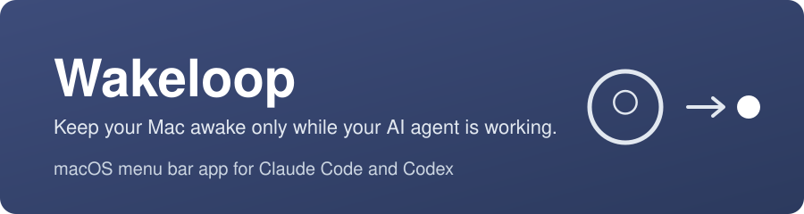
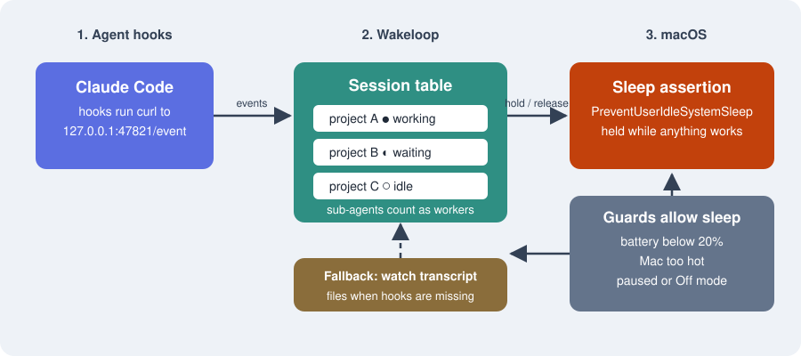
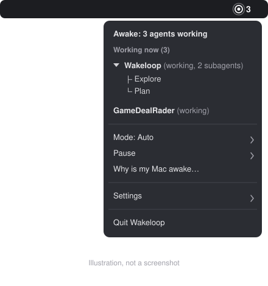

# Wakeloop

Keep your Mac awake while Claude Code works, then let it sleep.

Wakeloop is a small macOS menu bar app. While a Claude Code session is busy, it holds a macOS sleep assertion so a long task doesn't stall when you walk away. When every session is idle, it lets go and your Mac sleeps as usual.




*Illustrated demo, not a screen recording.*

## The problem

You start a long task in Claude Code and walk away. The Mac goes to sleep, and the agent stalls halfway through. The usual fix is `caffeinate`, but that also keeps the Mac awake after the agent has finished. Wakeloop holds the Mac awake only while Claude Code is busy.

## How it works



1. Claude Code hooks send a small event to Wakeloop on `127.0.0.1:47821` when a session starts, takes a prompt, asks for permission, or stops.
2. Wakeloop keeps a table of sessions, each one working, waiting or idle. Sub-agents count as workers.
3. While anything is working, Wakeloop holds a macOS sleep assertion. When every session is idle, it releases the assertion and the Mac can sleep.

"Sleep after" sets how long the Mac stays awake when Claude is waiting for you, for example at a permission prompt, before sleep is allowed. The default is 5 minutes. You can pick 1, 5, 10, 15 or 30 minutes under Settings, "Sleep after". Guards come first: low battery, a hot Mac, or a pause releases the hold.

## What you see



*Illustration, not a screenshot.*

The menu bar shows a small ring. While Wakeloop is not holding the Mac awake, the ring stays calm. While it is holding, the ring pulses and a bold count of working agents sits beside it.

The dropdown starts with a status line, then a "Working now" list of projects. A project with sub-agents expands into a tree. Click the project to expand or collapse it; the menu stays open. Below the list are:

- **Mode**: Auto, Always on (e.g. Remote Control), or Off.
- **Pause**: 30 minutes, 1 hour, until tomorrow, or Resume now.
- **Why is my Mac awake…**: a report of Wakeloop's state and every sleep assertion on the Mac.
- **Settings**: Sleep after, Max hold, Launch at login, and Lid-closed mode….
- **Quit Wakeloop**

On macOS 14.4 and later, some items show a short grey subtitle. The lid-closed window has "?" buttons with more detail.

## Install

Requires macOS 13 or later. Building needs Swift 5.9 or later (Xcode 15 or a matching Swift toolchain).

### Build from source

From the root of this repository:

```sh
swift test              # optional: run the unit tests
scripts/build-app.sh    # builds dist/Wakeloop.app, ad-hoc signed
open dist/Wakeloop.app
```

### Opening the app for the first time

Builds made by `scripts/build-app.sh` are ad-hoc signed and **not notarized by Apple**. Prebuilt builds, if you get one, are not notarized either. macOS will block the first launch. To allow it:

- Right-click (or Control-click) `Wakeloop.app`, choose **Open**, then click **Open** in the dialog; or
- Try to open it, then go to **System Settings > Privacy & Security**, find the message about Wakeloop, and click **Open Anyway**.

Only do this for a build you built yourself or got from a source you trust.

### Connect Claude Code

Open the Wakeloop menu, go to **Settings**, and choose **Set up Claude Code hooks…**. Wakeloop shows what it will change and asks you to confirm. It adds its hook entries to `~/.claude/settings.json`, keeps your other hooks where they are, and saves a timestamped backup next to the file first. Running it again changes nothing. To undo it, choose **Remove Claude Code hooks…**. Only Wakeloop's own entries are removed.

If your settings file is not valid JSON, Wakeloop refuses to touch it and tells you why. A read-only file is refused the same way.

Prefer to do it by hand? Print the config and merge it into your settings yourself:

```sh
wakeloop hook-snippet claude
```

The first time you open Wakeloop, a short setup guide opens. It covers the hooks, optional lid-closed mode, and a check that Claude Code can reach Wakeloop. Reopen it any time from **Settings > Show setup guide…**.

The `wakeloop` CLI is inside the app at `Wakeloop.app/Contents/Resources/bin/wakeloop`. The app must be running for the CLI to work.

## Features

- Claude Code is the only supported agent for now.
- One-click Claude Code hook setup in Settings, with Remove. Keeps your other hooks and backs up the settings file first.
- First-run setup guide with live status: the hooks, optional lid-closed setup, and a "Connected" check that turns green after your first Claude Code prompt. It opens once and can be reopened from Settings.
- Holds the Mac awake while a Claude Code session is working. In Auto mode it also keeps holding while a child process of the agent is busy, such as a long build or test run.
- Counts working agents in the menu bar, with project names and sub-agents listed under each project.
- Falls back to watching recently written session transcript files if the hooks are missing.
- Modes: Auto (the default), Always on, and Off.
- Pause for 30 minutes, 1 hour, or until 6 a.m. the next day. Resume at any time.
- Shortcuts: `Ctrl+Opt+Cmd+P` pauses or resumes, and `Ctrl+Opt+Cmd+M` cycles the mode.
- Crashed sessions expire: a working session with no hook event and no transcript write for 2 hours is dropped. A long silent command still holds through the process tree.
- Launch at login.
- A "Why is my Mac awake" window that shows Wakeloop's state, each session, busy processes, and every sleep assertion on the Mac.
- CLI for scripts and agents: `wakeloop hold --for 30m`, `wakeloop done`, `wakeloop hook-snippet claude`, and `wakeloop lid-setup`.

## Safety

- Sleep is allowed when the battery is at 20% or lower on battery. The hold comes back at 25%, or as soon as the charger is connected.
- Sleep is allowed when the Mac is too hot. Wakeloop sends a notification when this happens.
- Max hold: an automatic hold is released after 8 hours with no agent event or transcript write (Settings, "Max hold": 4, 8, 12 hours or Off). A notification says so. The next agent event brings the hold back. Always on and manual holds are not capped.
- Pause and Off release the hold.
- A sub-agent whose transcript has not been written for 3 minutes is dropped, since it was probably stopped. Any sub-agent still listed after 1 hour is dropped too.
- Wakeloop changes `~/.claude/settings.json` only when you choose Set up or Remove. It adds or removes only its own hook entries, backs the file up first, and never overwrites a file it cannot parse.

## Lid-closed mode (optional)

Lid-closed mode is off by default. Power assertions alone do not keep a closed Mac awake, so Wakeloop uses `pmset disablesleep`, which needs administrator rights.

Open **Settings > Lid-closed mode…** in the menu. The window has:

- **Set up…**, the first time. Wakeloop explains what it will do, then macOS shows its standard password dialog. After that one approval, Wakeloop can turn sleep prevention on and off by itself, using only two `pmset` commands. The sudoers rule is checked with `visudo` before it is installed. A watchdog restores normal sleep if the app quits or crashes.
- **Keep awake with lid closed**, a switch.
- **Power source**: **Charger only** (default), or **Charger or battery (stops at 30%, resumes at 35%)**. Choosing battery asks you to confirm first.
- **Remove setup…**, which removes the rule.

Charger only is the default because it is the safer choice. Prefer the terminal? `wakeloop lid-setup` prints the `sudoers` rule and the steps to install it. It changes nothing itself.

**Warning:** do not put a working Mac in a closed bag.

## Status

Wakeloop is an early pre-release (v0.1.0).

- **Agents:** Claude Code only. Codex detection is in place but has not been live-tested, so it is not supported yet.
- **Live-tested on the author's Mac:** building and launching the app, the hook server, Claude Code hooks, the working-agent count, project names, sub-agent tracking, the menu, modes, lid-closed setup, and lid-closed mode on the charger.
- **Not yet live-tested:** the in-app hook setup and removal, the setup guide, the "Sleep after" timeout, the max hold and crashed-session expiry, the battery guard, launch at login, the global shortcuts, lid-closed mode on battery, and process-tree behaviour (keeping the Mac awake while a child process runs).
- The unit tests run with `swift test`.

## Support

Wakeloop is free and open source under the MIT License.

- Found a bug or want a feature? Open an issue. The issue templates ask for what we need.
- Pull requests are welcome. Start with `swift test` before you open one.
- If Wakeloop saves you a sleeping agent, a star on the repository helps others find it.
- Want to say thanks? [Buy me a coffee on Ko-fi](https://ko-fi.com/koushikdas).

## Versions

- `main` is the stable branch. `dev` is for new work.
- The first version is tagged `v0.1.0`, a pre-release.

## License

[MIT](LICENSE).
